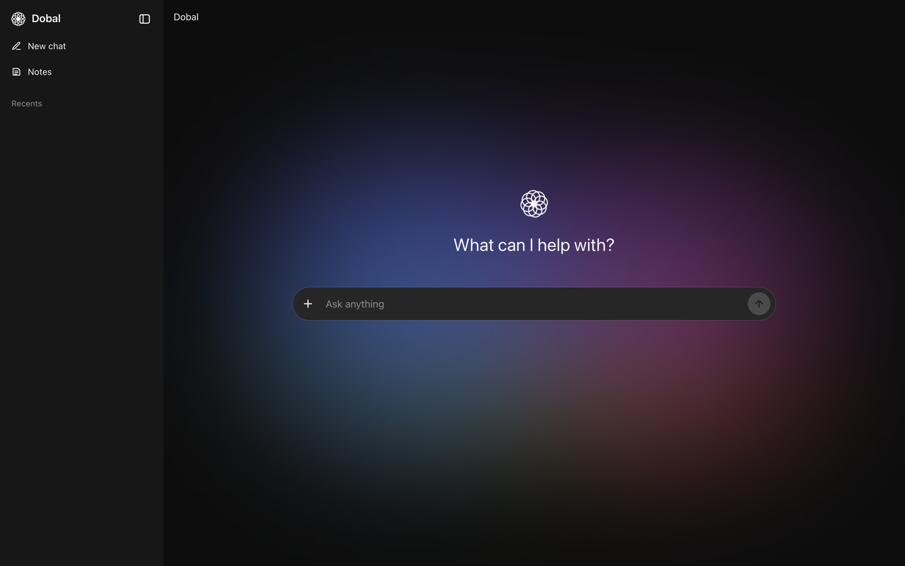
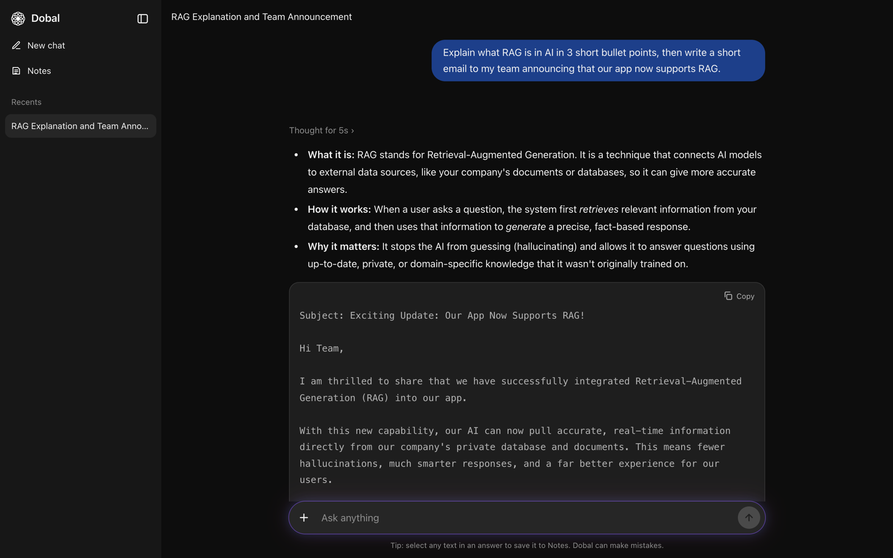
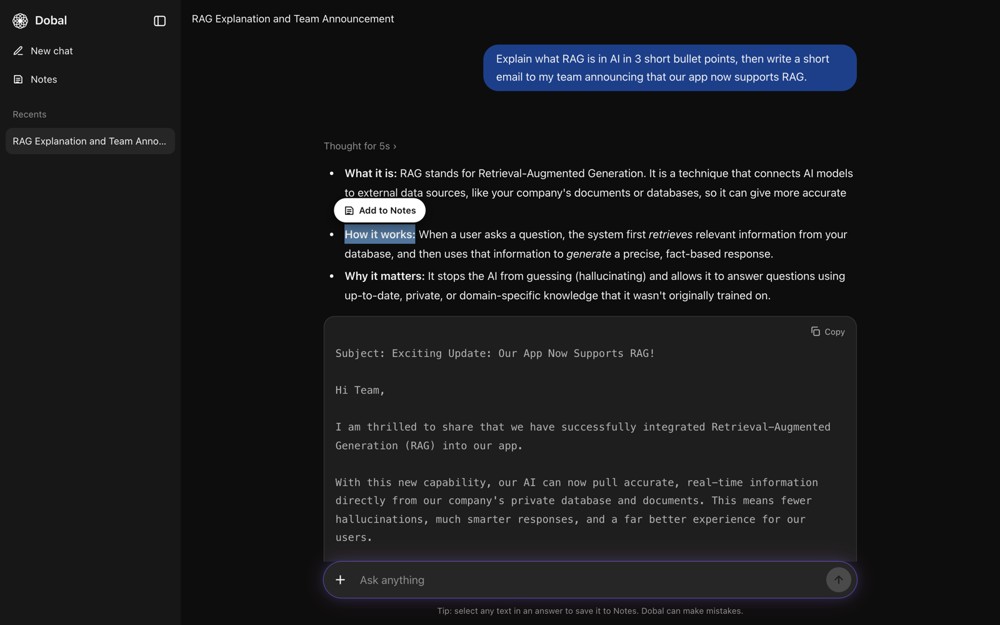
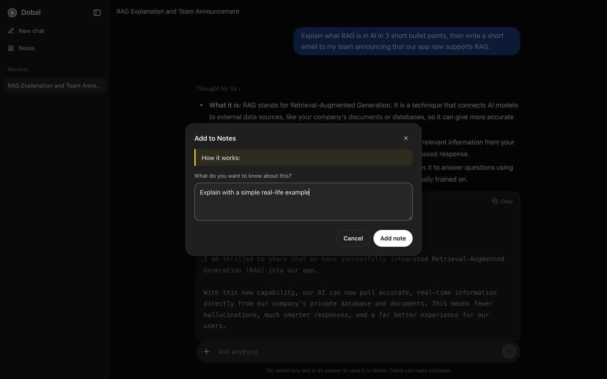
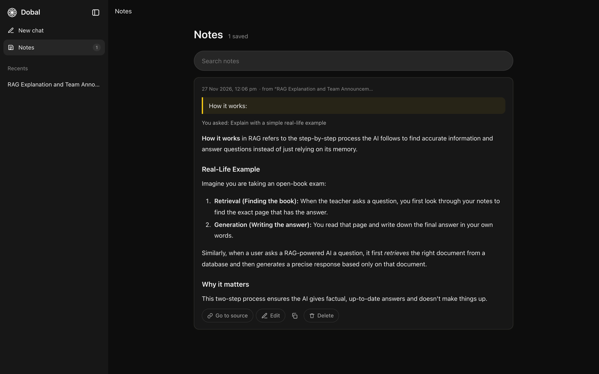
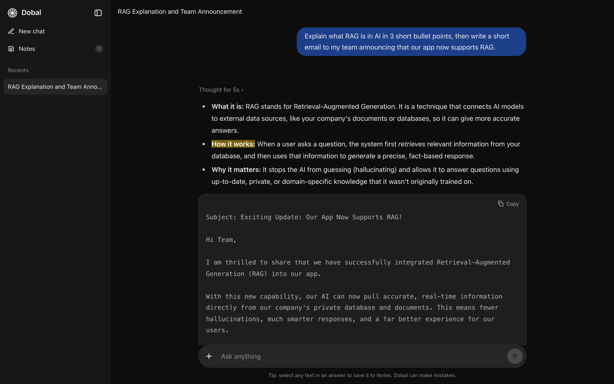
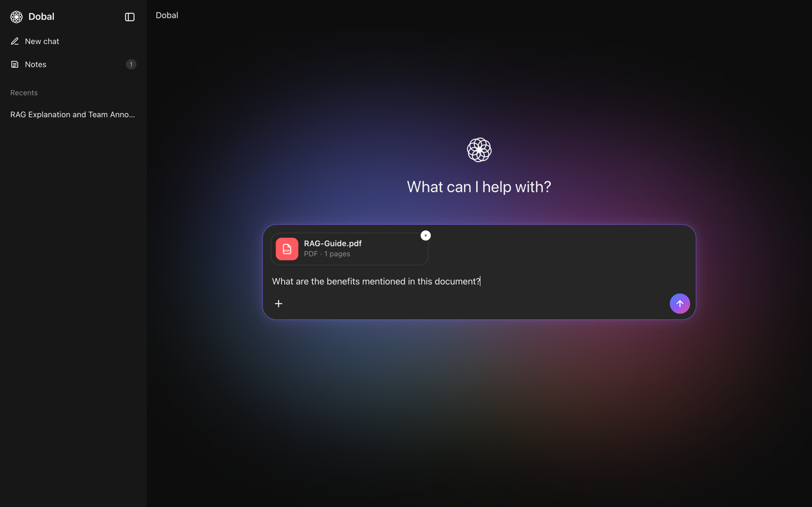
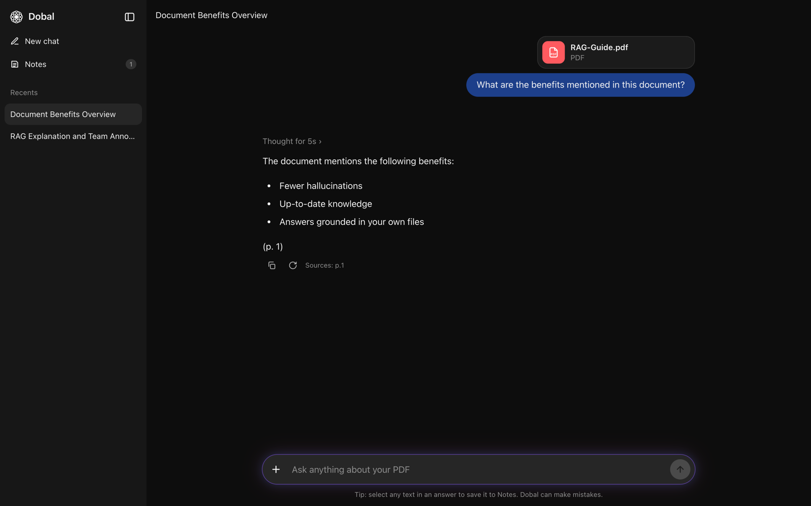
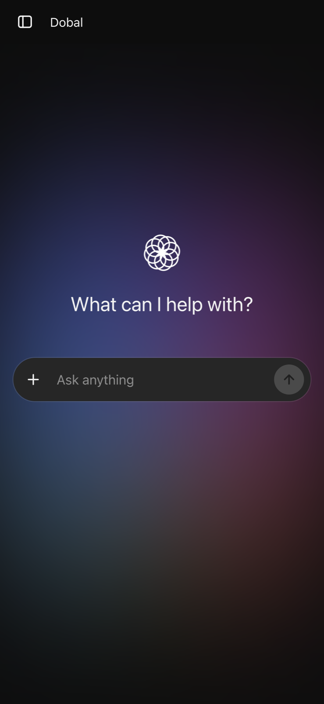
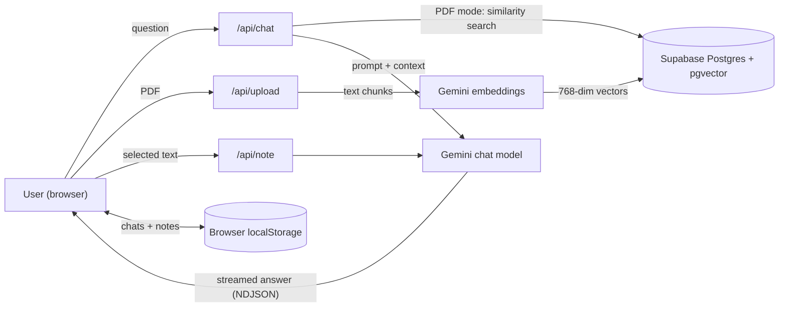

<p align="center">
  
</p>

<h1 align="center">Dobal</h1>

<p align="center">
  <b>Your AI assistant: ask anything, chat with your PDFs, and turn answers into your own study Notes.</b>
</p>

<p align="center">
  <a href="https://ai-pdf-chat-phi.vercel.app"><b>🌐 Live demo</b></a> ·
  <a href="#-features">Features</a> ·
  <a href="#-screenshots">Screenshots</a> ·
  <a href="#-how-it-works">How it works</a> ·
  <a href="#-getting-started">Getting started</a> ·
  <a href="#-deployment">Deployment</a>
</p>

<p align="center">
  
  
  
  
  
  
</p>



---

## ✨ Features

### 💬 Ask anything
- A general-purpose AI assistant, like ChatGPT or Claude: studies, coding, business, writing, advice and more.
- Replies in **your language** (English, Hindi, Hinglish…).
- **Streaming answers**: text appears word by word, with a live "Thinking…" indicator.
- Clean **Markdown** formatting: headings, bullet lists, tables, bold, inline code.
- **Copyable boxes**: emails, messages, templates and code come in a separate box with a one-click **Copy** button.

### 📄 Chat with your PDFs
- Attach a PDF with the **+** button. It is read, split into passages and indexed with AI embeddings.
- Answers come from the document with **page citations** (e.g. *p. 3*).
- You can still ask general questions in the same chat.
- Safe limits: max **4 MB / 50 pages**. Files are validated (`%PDF` header). PDFs are **auto-deleted after 7 days**, and Dobal tells you if a PDF has expired.

### 📝 Notes: learn while you read
1. **Select** any word or sentence in an answer.
2. Click **Add to Notes**. Dobal asks *"What do you want to know about this?"* (optional).
3. Dobal writes a clear explanation and saves it to the **Notes** tab with:
   - the selected text,
   - your question,
   - the AI explanation,
   - the **date and time** it was added,
   - a **Go to source** back-link that opens the original chat, scrolls to the message and **highlights the exact line**.
- Notes can be **searched, edited, copied and deleted**.

### ⚡ ChatGPT-style experience
- Sidebar with **chat history** (Recents) and **New chat**.
- **AI-generated chat titles**.
- **Stop** generating at any time.
- **Edit** your message to re-ask, or **Regenerate** the last answer.
- Fully **responsive**: works on mobile with a collapsible sidebar.
- Animated multicolor glow and a minimal white logo.

---

## 📸 Screenshots

### General chat: Markdown + copyable email box


### Select any text to add it to Notes


### Dobal asks what you want to know


### Notes tab: date, question, explanation, edit and back-link


### "Go to source" highlights the exact line in the original chat


### Chat with a PDF
| Attach a PDF | Answer with page citations |
|---|---|
|  |  |

### Mobile


---

## 🧠 How it works



### PDF chat (RAG: Retrieval-Augmented Generation)
1. **Upload:** PDF → text per page (`unpdf`) → overlapping ~1000-character chunks.
2. **Embed:** chunks → Gemini embeddings (768 dimensions) → stored in the `chunks` table (pgvector, HNSW index).
3. **Retrieve:** the question is embedded → `match_chunks()` cosine search → top 6 passages.
4. **Generate:** passages + question + recent conversation → Gemini → streamed answer with page sources.

### Notes
- `/api/note` receives the selected text, your question and the surrounding answer, and streams back a focused explanation.
- Notes and chats are stored in the browser (`localStorage`). Each note keeps the `chatId` + `messageId` of its source. **Go to source** uses the CSS Custom Highlight API to highlight the exact text.

### Reliability and safety
- **Model fallback:** if a Gemini model is busy or slow, Dobal retries and switches to the next model automatically.
- **Retry with backoff** for embedding rate limits (429/503).
- **Rate limiting** per IP (Upstash Redis, with an in-memory fallback): 30 messages / 10 min and 200 / day, plus 5 uploads / hour.
- The Supabase **service-role key stays on the server**; Row Level Security is enabled on all tables.
- A daily **GitHub Action** keeps the free Supabase project awake and deletes PDFs older than 7 days.

---

## 🛠 Tech stack

| Layer | Technology |
|---|---|
| Frontend | Next.js 15 (App Router), React 19, TypeScript, `react-markdown` + GFM |
| AI | Google Gemini (`@google/genai`): chat models with fallback + `gemini-embedding-001` |
| Database | Supabase Postgres + **pgvector** (HNSW cosine index) |
| PDF parsing | `unpdf` |
| Rate limiting | Upstash Redis (REST) |
| Hosting | Vercel (serverless functions, streaming responses) |
| Automation | GitHub Actions (daily keep-alive + cleanup) |

### Project structure
```text
app/
  page.tsx            # Chat UI, sidebar, Notes tab, selection → Add to Notes
  globals.css         # ChatGPT-style dark theme
  icon.svg            # Favicon (Dobal logo)
  api/
    chat/route.ts     # General + PDF (RAG) chat, streamed
    note/route.ts     # Explains selected text for Notes
    title/route.ts    # AI chat titles
    upload/route.ts   # PDF → chunks → embeddings → Supabase
    health/route.ts   # Keep-alive + delete PDFs older than 7 days
lib/
  llm.ts              # Gemini streaming with model fallback + style rules
  server.ts           # Gemini/Supabase clients, embeddings, rate limiting
  progress.ts         # NDJSON progress-event protocol
supabase/schema.sql   # Tables, pgvector index, match_chunks()
.github/workflows/keep-alive.yml
```

---

## 🚀 Getting started

### Prerequisites
- Node.js 18+
- A free [Supabase](https://supabase.com) project
- A [Gemini API key](https://aistudio.google.com/apikey)

### 1. Clone and install
```bash
git clone https://github.com/Luckykumawat/AI_PDF_Chat.git dobal
cd dobal
npm install
```

### 2. Set up the database
Open Supabase → **SQL Editor** → run [`supabase/schema.sql`](supabase/schema.sql).

### 3. Environment variables
```bash
cp .env.example .env.local
```

| Variable | Required | Description |
|---|---|---|
| `GEMINI_API_KEY` | ✅ | From Google AI Studio |
| `NEXT_PUBLIC_SUPABASE_URL` | ✅ | Supabase → Project Settings → API |
| `SUPABASE_SERVICE_ROLE_KEY` | ✅ | Server-only secret key. Never expose it to the browser |
| `GEMINI_CHAT_MODEL` | optional | Preferred chat model (fallbacks are built in) |
| `GEMINI_EMBED_MODEL` | optional | Defaults to `gemini-embedding-001` |
| `UPSTASH_REDIS_REST_URL` / `UPSTASH_REDIS_REST_TOKEN` | optional | Shared rate limiting (also reads `KV_REST_API_URL` / `KV_REST_API_TOKEN`) |

### 4. Run
```bash
npm run dev       # http://localhost:3000
npm run typecheck
npm run build
```

---

## ☁️ Deployment

1. Import the repository on [Vercel](https://vercel.com/new) and add the environment variables above.
2. *(Recommended)* Vercel → **Storage / Marketplace → Upstash for Redis** → connect to the project → redeploy.
3. GitHub → **Settings → Secrets and variables → Actions** → add `APP_URL` = your Vercel URL (no trailing slash).
   The workflow [`keep-alive.yml`](.github/workflows/keep-alive.yml) calls `/api/health` daily.

Every push to `main` is deployed automatically by Vercel.

---

## 🗺 Roadmap
- [ ] Login with Supabase Auth
- [ ] Sync chats and notes to Supabase (access from any device)
- [ ] Multiple PDFs per chat
- [ ] OCR for scanned PDFs (Gemini vision)
- [ ] Export notes to PDF / Markdown
- [ ] Voice input

---

<p align="center">Made by <a href="https://github.com/Luckykumawat">Lokesh Kumawat</a></p>
